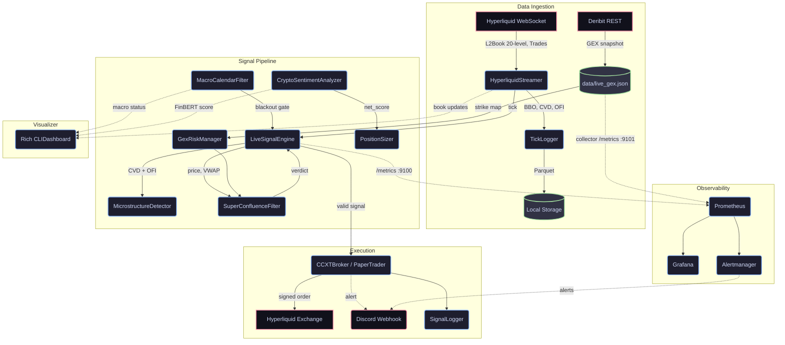

# Crypto-Quant

A modular, asynchronous algorithmic trading system for **Hyperliquid L1
perpetual futures**. Signal generation uses Smart Money Concept microstructure
analysis (CVD/OFI absorption) gated by Deribit Gamma Exposure, macro event
blackout windows, and FinBERT sentiment scoring.

Paper-trading by default. Live mode is a single env-var flip.

---

## Architecture



For a detailed breakdown of every module and the rationale behind each design
decision, see [ARCHITECTURE.md](./ARCHITECTURE.md).

---

## Stack

| Layer          | Technology                                          |
|----------------|-----------------------------------------------------|
| Language       | Python 3.11+ (`src/` layout, PEP 621 packaging)     |
| Exchange       | Hyperliquid L1 (WebSocket + REST via CCXT)          |
| Options data   | Deribit REST (GEX snapshots)                        |
| Async          | `asyncio`                                           |
| Sentiment NLP  | ProsusAI/FinBERT (`transformers`)                   |
| Data storage   | Apache Parquet (`pyarrow`)                          |
| Terminal UI    | `rich`                                              |
| Containers     | Docker (multi-stage, non-root), Docker Compose      |
| Observability  | Prometheus, Grafana, Alertmanager, node-exporter, cAdvisor |
| IaC            | Terraform (`hetznercloud/hcloud`) + cloud-init      |
| CI/CD          | GitHub Actions, GHCR, Trivy, Hadolint, Dependabot   |
| Quality        | `ruff`, `mypy`, `pytest` + coverage, pre-commit, gitleaks |

---

## Repository layout

```
src/crypto_quant/      application package (config, data_ingestion, execution,
                       quant_models, research, visualizer, observability, main.py)
tests/                 pytest suite
monitoring/            Prometheus, alert rules, Alertmanager, Grafana provisioning
infra/terraform/       Hetzner Cloud IaC + cloud-init
docs/                  ADRs and the alert runbook
Dockerfile, docker-compose.yml, Makefile
```

---

## Quickstart with Docker (recommended)

Requires Docker Engine 24+ / Docker Desktop with Compose v2.

```bash
git clone https://github.com/Ad1xon/crypto-bot.git
cd crypto-bot
cp .env.example .env                       # edit as needed, paper trading by default

# bot + Deribit GEX collector
docker compose up -d --build
docker compose ps                          # STATUS shows (healthy) once data flows
docker compose logs -f bot                 # JSON logs on stdout

# + monitoring stack (Prometheus, Grafana, Alertmanager, node-exporter, cAdvisor)
mkdir -p secrets && echo "<discord webhook url>" > secrets/discord_webhook_url
docker compose --profile monitoring up -d --build

docker compose --profile monitoring down   # stop everything (data/ is kept)
```

| Service      | URL                          | Notes                                |
|--------------|------------------------------|--------------------------------------|
| Grafana      | http://localhost:3000        | `GRAFANA_ADMIN_*` from `.env`, dashboard *Crypto-Quant / Overview* |
| Prometheus   | http://localhost:9090        | targets, alerts, PromQL              |
| Alertmanager | http://localhost:9093        | routes to Discord                    |
| Bot metrics  | `bot:9100/metrics` (internal) | not published to the host           |

All UIs bind to `127.0.0.1` only. On Linux hosts make the bind mounts writable for
the container user: `sudo chown -R 10001:10001 data logs`.

The container runs headless (`DASHBOARD_ENABLED=false`). For the Rich terminal UI
use the local install below.

---

## Local install (development / Rich dashboard)

```bash
python -m venv venv
venv\Scripts\activate        # Windows
# source venv/bin/activate   # Linux / macOS

pip install --index-url https://download.pytorch.org/whl/cpu "torch>=2.2.0"
pip install -e ".[dev]"
pre-commit install

cp .env.example .env
crypto-quant                 # trading loop + Rich UI   (or: python -m crypto_quant)
crypto-quant-gex             # Deribit GEX collector, separate terminal
python -m crypto_quant.research.event_backtester --symbol btc
```

---

## Development

```bash
pytest                       # tests
pytest --cov                 # with coverage
ruff check . --fix && ruff format .
mypy src
make help                    # all shortcuts (Git Bash / WSL / Linux)
```

CI (`.github/workflows/ci.yml`) runs lint, mypy, a Python 3.11/3.12 test matrix with
coverage, compose/Prometheus/Alertmanager config validation, `terraform validate`,
Hadolint + Trivy scans, then builds, smoke-tests and pushes the image to
`ghcr.io/ad1xon/crypto-bot` (tags: `sha-<short>`, `latest`, semver on `v*` tags).

---

## Deployment (Hetzner Cloud)

```bash
cd infra/terraform
cp terraform.tfvars.example terraform.tfvars      # set admin_cidrs to your IP
$env:TF_VAR_hcloud_token = "<token>"               # bash: export TF_VAR_hcloud_token=...
terraform init
terraform plan -out=tfplan
terraform apply tfplan

scp ../../.env deploy@$(terraform output -raw server_ipv4):/opt/crypto-quant/.env
ssh deploy@<ip> "cd /opt/crypto-quant && docker compose --env-file .env --env-file .compose.env --profile monitoring up -d"

terraform output grafana_tunnel                    # SSH tunnel to Grafana/Prometheus
```

Subsequent releases: GitHub Actions -> *Deploy* workflow (manual, `production`
environment approval, health-verified). Alerts and responses: [docs/RUNBOOK.md](./docs/RUNBOOK.md).

Why Compose and not Kubernetes: [ADR-0001](./docs/adr/0001-docker-compose-over-kubernetes.md).
Monitoring design: [ADR-0002](./docs/adr/0002-prometheus-grafana-observability.md).
Infrastructure: [ADR-0003](./docs/adr/0003-hetzner-terraform-infrastructure.md).

---

## Instruments

| Symbol | Exchange    | Type      | Status  |
|--------|-------------|-----------|---------|
| `BTC`  | Hyperliquid | Perpetual | Active  |
| `ETH`  | Hyperliquid | Perpetual | Planned |
| `SOL`  | Hyperliquid | Perpetual | Planned |

---

## Status

Paper trading. Live execution via `LIVE_MODE=True` targets Hyperliquid testnet
by default (`USE_TESTNET=True`). Flip both flags only after validating the
backtest Profit Factor on historical tick data.
