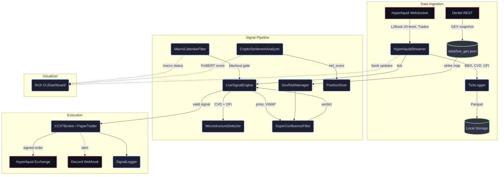

# Crypto-Quant

A modular, asynchronous algorithmic trading system for **Hyperliquid L1
perpetual futures**. Signal generation uses Smart Money Concept microstructure
analysis (CVD/OFI absorption) gated by Deribit Gamma Exposure, macro event
blackout windows, and FinBERT sentiment scoring.

Paper-trading by default. Live mode is a single env-var flip.

---

## Architecture



For a detailed breakdown of every module and the rationale behind each design
decision, see [ARCHITECTURE.md](./ARCHITECTURE.md).

---

## Stack

| Layer          | Technology                                          |
|----------------|-----------------------------------------------------|
| Language       | Python 3.10+                                        |
| Exchange       | Hyperliquid L1 (WebSocket + REST via CCXT)          |
| Options data   | Deribit REST (GEX snapshots)                        |
| Async          | `asyncio`                                           |
| Sentiment NLP  | ProsusAI/FinBERT (`transformers`)                   |
| Data storage   | Apache Parquet (`pyarrow`)                          |
| Terminal UI    | `rich`                                              |
| Linting        | `ruff`                                              |
| Testing        | `pytest` + `pytest-asyncio`                         |
| CI/CD          | GitHub Actions                                      |

---

## Quickstart

```bash
# 1. Clone and create virtual environment
git clone https://github.com/Ad1xon/crypto-bot.git
cd crypto-bot
python -m venv venv
venv\Scripts\activate        # Windows
# source venv/bin/activate   # Linux / macOS

# 2. Install dependencies
pip install -r requirements.txt

# 3. Configure
cp .env.example .env
# Edit .env — set TRADING_SYMBOL, USE_TESTNET, etc.

# 4. Run (paper trading by default)
python main.py
```

---

## Development

```bash
# Install pre-commit hooks (enforces ruff before every commit)
pip install pre-commit
pre-commit install

# Run tests
pytest

# Lint + format
ruff check . --fix
ruff format .
```

---

## Instruments

| Symbol | Exchange    | Type      | Status  |
|--------|-------------|-----------|---------|
| `BTC`  | Hyperliquid | Perpetual | Active  |
| `ETH`  | Hyperliquid | Perpetual | Planned |
| `SOL`  | Hyperliquid | Perpetual | Planned |

---

## Status

Paper trading. Live execution via `LIVE_MODE=True` targets Hyperliquid testnet
by default (`USE_TESTNET=True`). Flip both flags only after validating the
backtest Profit Factor on historical tick data.
