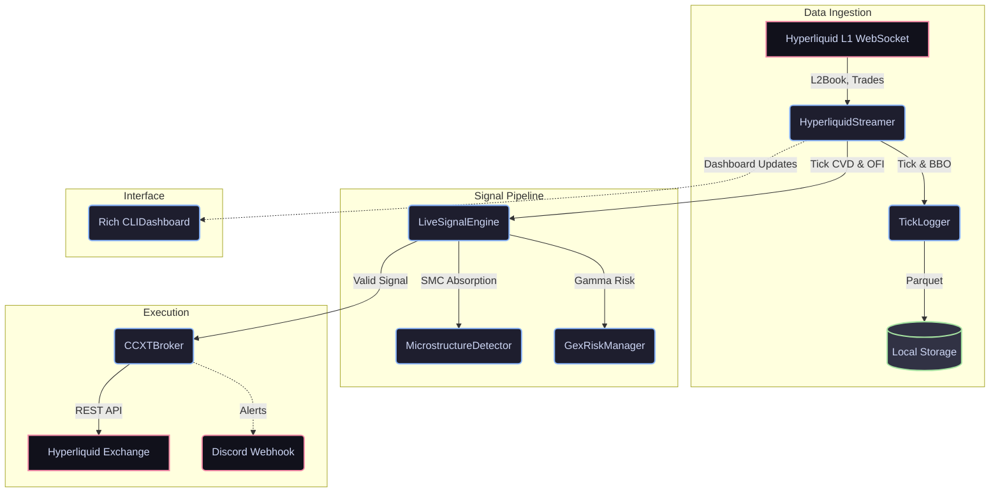

# Crypto-Quant 📈

An advanced, asynchronous algorithmic trading system tailored for high-frequency data ingestion and order execution. Recently migrated to **Hyperliquid DEX** for zero gas fees, low latency, and no geo-blocking restrictions.

## Current Architecture

Below is a high-level representation of the current architecture:

## Features
- **Hyperliquid Integration**: Native asynchronous streams parsing L2 orderbooks and trades.
- **Smart Money Concepts (SMC)**: Microstructure detectors searching for real-time absorptions using Order Flow Imbalance (OFI) and Cumulative Volume Delta (CVD).
- **Gamma Exposure (GEX)**: Risk management layer that calibrates positions according to the derivatives market's gamma profile.
- **Async Execution**: `CCXTBroker` leverages `ccxt.async_support` for rapid, non-blocking order placement.

## Next Steps / Roadmap
1. **Fleshing out Hyperliquid Data Parse**: Adapting the multi-level L2Book snapshot diffs perfectly into our internal book state.
2. **Backtesting Pipeline**: Wiring historical data into the `LiveSignalEngine` via an offline simulator.
3. **Position Sizing**: Dynamically calculating Kelly fractions / risk based on account equity and current market GEX.
4. **Execution Logic**: Tracking real positions in `ccxt_broker` against Hyperliquid's REST API for trailing stops.
